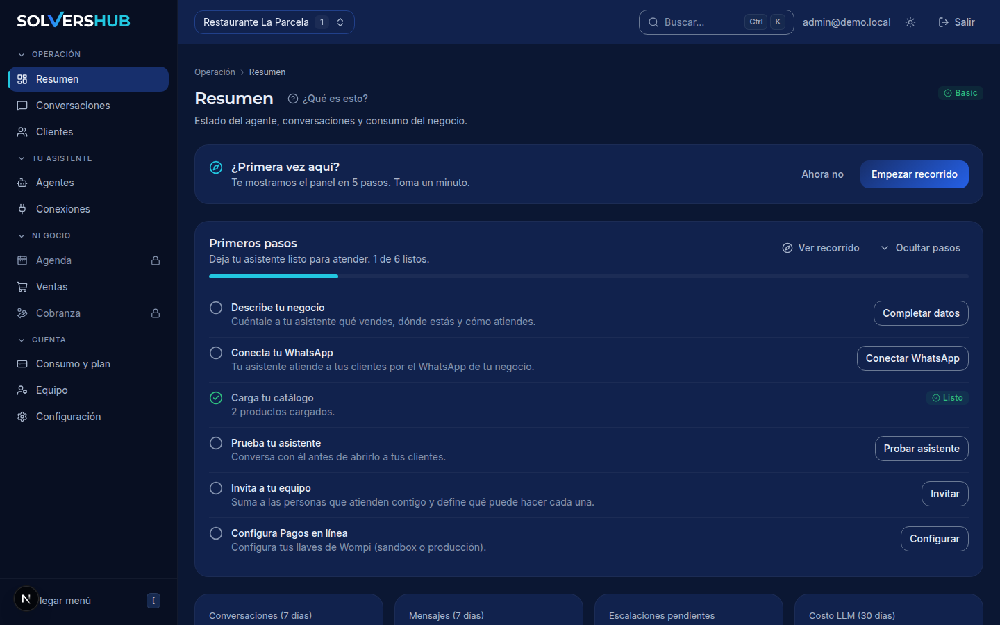
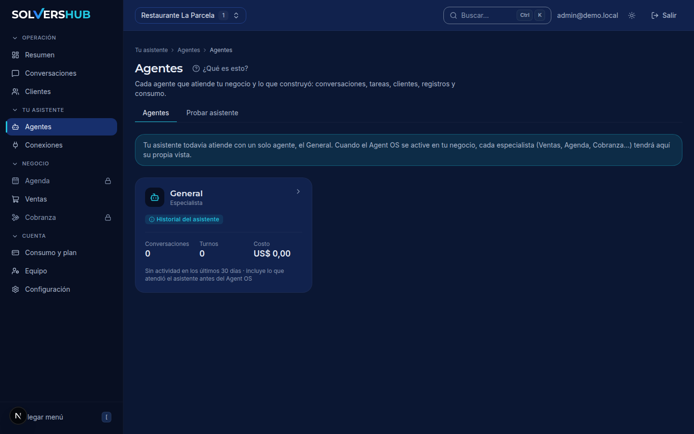
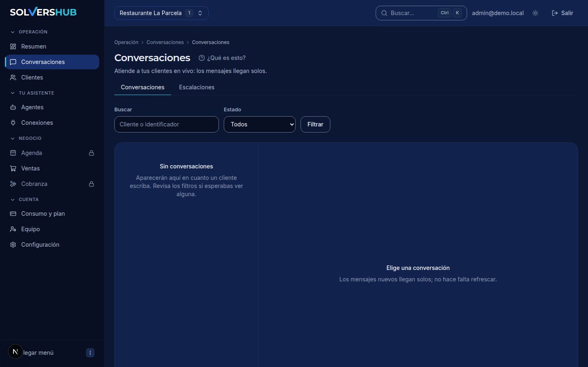
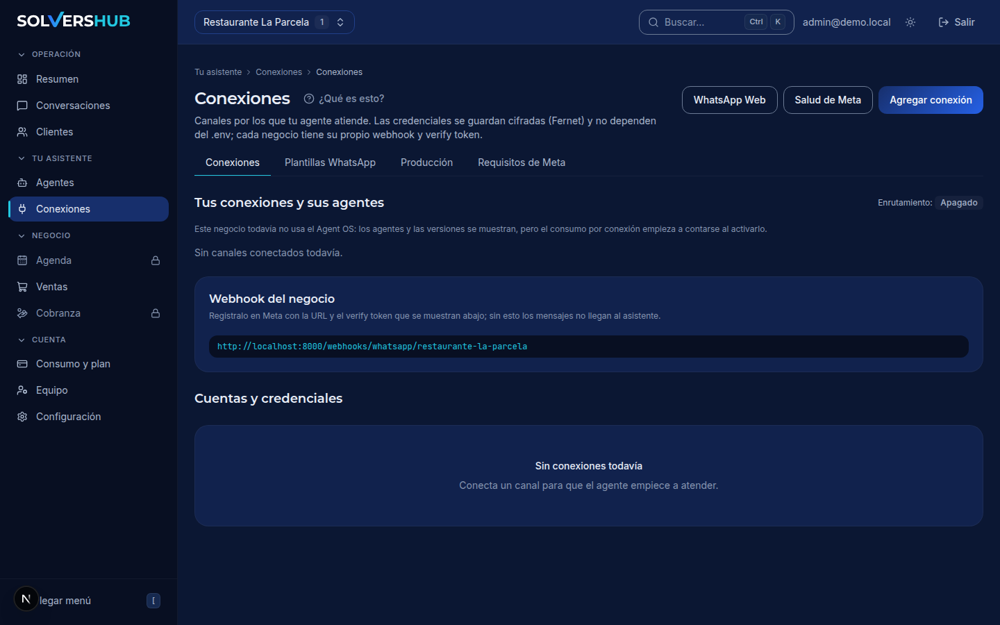

# solvershub-panel

> **The admin panel for a multi-tenant AI agent platform — Next.js 16, React 19, Tailwind v4 and shadcn/ui.**

[](https://github.com/devrochy/solvershub-panel/actions/workflows/ci.yml)
[](LICENSE)

**TL;DR** — solvershub-panel is where businesses onboard, configure and operate
their AI agents: tenant setup, agent editing, channel connections, the live
conversations inbox, agenda, billing and observability — all over the
[agent-core](https://github.com/devrochy/agent-core) API.

| | |
|---|---|
| **Problem** | Operating a fleet of AI agents for many businesses requires a panel that non-engineers can use and engineers can trust. |
| **What I built** | A typed, server-rendered admin panel with a generated API client, a design-token system shared with the mobile app, and a component kit tested for accessibility. |
| **Proof** | 240 commits · 75 test files · Vitest + Testing Library + axe-core · CI gate on every PR. |

## What it does

- **Tenant onboarding:** guided first steps, production checklist and automatic
  provisioning flows.
- **Agent editor:** create and configure agents (identity, provider, model,
  skills, memory and rules) with a JSON Schema Form generator.
- **Connections console:** connect WhatsApp channels, verify webhooks and
  diagnose delivery.
- **Live inbox:** conversations with human handoff and escalation management.
- **Agenda and billing:** calendar for appointments, plans, credits and usage.
- **Design system:** brand tokens as the single source of truth, dark theme by
  default, data visualization components and a QA kit with accessibility gates.

## Stack

Next.js 16 (App Router) · React 19 · TypeScript · Tailwind CSS v4 · shadcn/ui ·
FullCalendar · d3 · Vitest · Testing Library · axe-core · openapi-typescript.

## Demo

Running locally against a seeded [agent-core](https://github.com/devrochy/agent-core) instance (dark theme by default):

| Dashboard | Agent editor | Live inbox | Connections |
|---|---|---|---|
|  |  |  |  |

## Structure

| Path | What it is |
|---|---|
| [`apps/panel-web/`](apps/panel-web/) | The panel application (SSR, typed API client) |
| [`brand/`](brand/) | Brand manual, logo sources and design tokens |

## Quickstart

```bash
cd apps/panel-web
npm install
cp .env.example .env.local   # point the panel at an agent-core API
npm run dev
```

## Commands

| Command | What it does |
|---|---|
| `npm run dev` / `npm run build` | Development / production build |
| `npm run lint` / `npm run typecheck` | ESLint / TypeScript |
| `npm test` | Vitest + Testing Library (unit and component) |
| `npm run test:coverage` | Coverage report |
| `npm run api:types` | Regenerate the API client from the backend OpenAPI schema |
| `npm run tokens:sync` | Sync design tokens from `brand/tokens/tokens.json` |

## Testing

75 test files cover the shell, navigation, forms, data tables, dataviz, access
control and theme tokens — including accessibility checks with axe-core.

## Related repositories

| Repo | What it is |
|---|---|
| [agent-core](https://github.com/devrochy/agent-core) | The multi-tenant Python runtime this panel manages |
| [solvershub-apk](https://github.com/devrochy/solvershub-apk) | The field app that shares this design system |
| [spec-driven-development](https://github.com/devrochy/spec-driven-development) | The public planning system behind the platform |

## License

MIT. See [LICENSE](LICENSE).

## Contact

[LinkedIn](https://linkedin.com/in/robinson-aguilar-ramirez-8970a1129) · [Email](mailto:devrochy@gmail.com)
